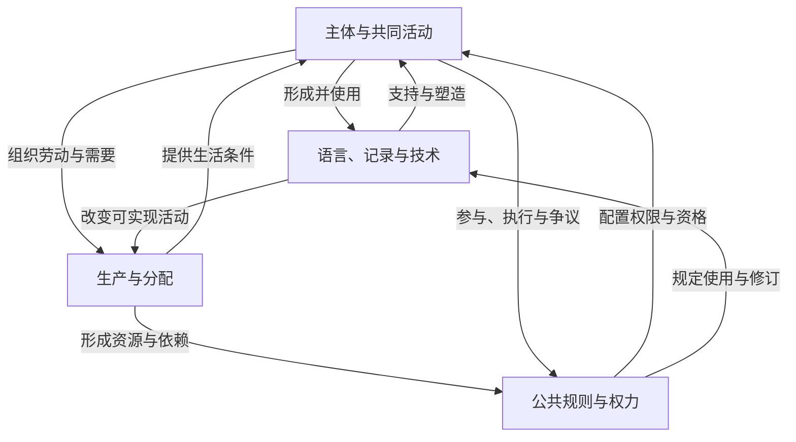

# 生成与自由

## 计算、主体与社会的理论

**第二版修订稿 · 版本 2.0 · 研究截止：2026 年 11 月 28 日**

人借助语言、工具和制度改变世界，这些条件也在塑造人的能力、目的与自我理解。本书从过程与计算的数学基础出发，研究组织、主体、历史、经济和政治的形成，进而提出自由的概念：人参与形成、维持与修订自身目的及共同生活条件的有效能力与地位。

全书共七部、37 章，另有导论与结语。前六部建立基础和一般理论，第七部独立分析 AI 时代，提出替代成本、就业与分配的机制判断、六项分时段预测，以及保障、收益权、治理和纠错的制度构造。

## 第二版的修订重点

本版逐章重构论证，扩大与原始文献的对话。数学基础加入观察与闭包的区别、部分观察下的维持、近似误差和分散协调；主体与历史部分加强功能意义、公共理由、技术组织与制度再生产之间的连接；经济与政治部分比较知识生成、产权、共同维护、权力依赖与公共执行；自由论集中回应目的形成、平等地位、照护和家长主义。

AI 部分比较任务成本、增长瓶颈、专家能力扩散与转职摩擦，推导复核选择、劳动需求及能力存量的关系，保留六项有时间窗与撤回条件的预测。最后分别讨论现金、公共服务、岗位、资产收益和共同治理的作用与约束。

新增篇幅用于把机制和争论展开。各部调研同时记录实际读取范围；只有摘要可得的材料不作为已核对全文使用。全部正文、文献与修订记录汇编在同一合订稿中。

## 开始阅读

- [逐章目录](src/SUMMARY.md)：按全书论证次序阅读。
- [完整合订稿](MANUSCRIPT.md)：包括全部正文与研究附录，便于统一检索。
- [导论：生成的世界与自由的问题](src/00-introduction.md)：理论对象、核心概念与证据标准。
- [论证与思想对话总表](research/08-argument-map.md)：查看各部之间的连接，以及与既有研究的继承、改写和争论。
- [校订与核查记录](research/09-editorial-review.md)：第二版完成范围、形式核查、资料边界及修订办法。
- [逐章修订说明](research/10-v2-revision.md)：各章新增的争点、机制与论证，与第一版逐项比较。

## 七部安排

| 部 | 正文 | 要解决的问题 | 文献调研 |
| --- | --- | --- | --- |
| 一 | [过程、计算与组织的数学基础](src/01-process-and-realization.md)，第 1—8 章 | 观察、计算、尺度、行动与维持怎样具有共同的形式基础？ | [第一部调研](research/01-foundations.md) |
| 二 | [组织、意义与主体的生成](src/09-boundaries-and-persistence.md)，第 9—13 章 | 边界、记录、目的和自我描述怎样成为一种持续活动的组成？ | [第二部调研](research/02-agency.md) |
| 三 | [语言、技术与历史的生成](src/14-communication-and-language.md)，第 14—18 章 | 活动的产物怎样成为后来活动与行动者的形成条件？ | [第三部调研](research/03-history.md) |
| 四 | [经济的一般理论](src/19-needs-and-production.md)，第 19—23 章 | 生活条件怎样被生产、分配和再生产？ | [第四部调研](research/04-economy.md) |
| 五 | [政治的一般理论](src/24-power-and-interdependence.md)，第 24—28 章 | 改变共同条件的权力怎样形成、执行、限制和争夺？ | [第五部调研](research/05-politics.md) |
| 六 | [自由、价值与共同生活](src/29-capabilities-and-standing.md)，第 29—32 章 | 有效能力、参与地位和共同修订怎样构成自由？ | [第六部调研](research/06-freedom.md) |
| 七 | [AI 时代的变化、判断与制度实践](src/33-ai-and-technical-externalization.md)，第 33—37 章 | 新的技术外化怎样改变劳动、收益、公共资格与治理？ | [第七部调研](research/07-ai-era.md) |

## 论证的连接

下图只展示主体、技术与制度之间的相互形成。各条关系的机制和范围在正文中分别论证。



第一部为这些关系提供形式区分，第六部对其自由意义进行规范评价。二阶控制论使观察者及其分类也进入考察；本书进一步追问这些观察者、目的和分类本身怎样形成。

## 怎样使用文献与公式

正文采用部内文献编号，例如“〔I-03〕”。相应调研文件列出作者、年份、题名、原始链接、支持的论点和适用边界。数学命题写明条件并给出证明；社会应用另行说明对应关系。构造例子用于解释机制，不作为调查结果。

书稿中的思想综合、概念安排和未来判断需要接受持续检验。既有概念和研究按来源归属，本版通过竞争解释、反例和具体推导展示其可能的解释增量，并保留需要后续材料检验的判断。

## 版本与维护

逐章源文件位于 [src/](src/)，调研及核查资料位于 [research/](research/)。[共同术语与研究方法](research/00-method-and-terms.md)记录跨部用法；[book.json](book.json)记录版本及篇章次序；[STATS.json](STATS.json)记录正文汉字数、各部规模、引用条目数和章节内容校验值。

在仓库根目录运行：

```bash
python books/generation-and-freedom/tools/assemble.py
```

这会重新生成逐章目录、合订稿和规模记录，并检查章节齐全性、文献编号、公式分隔符和本地链接。它不会验证理论结论，也不代替对正文和原始资料的阅读。
